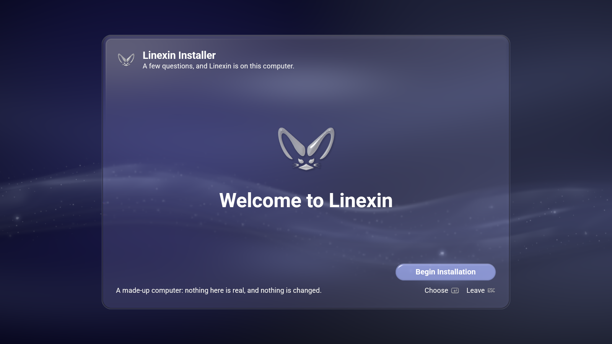
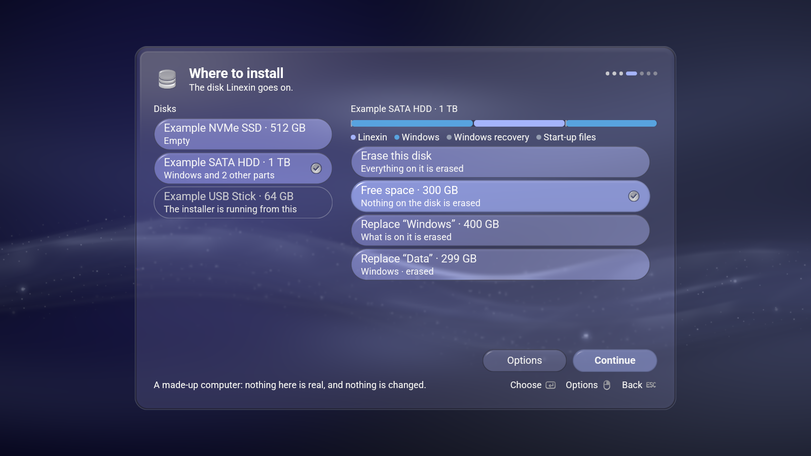
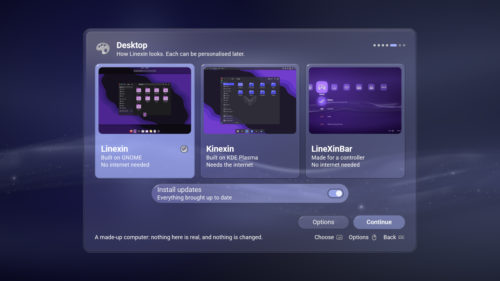
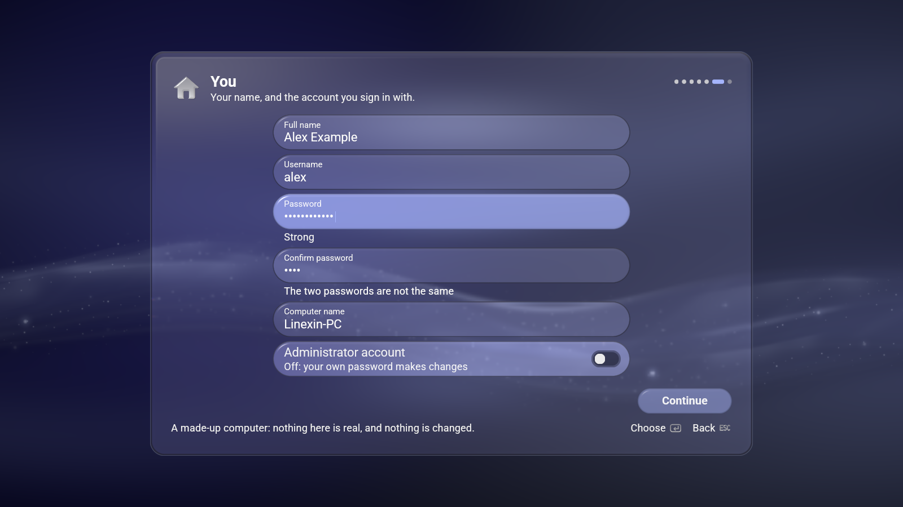
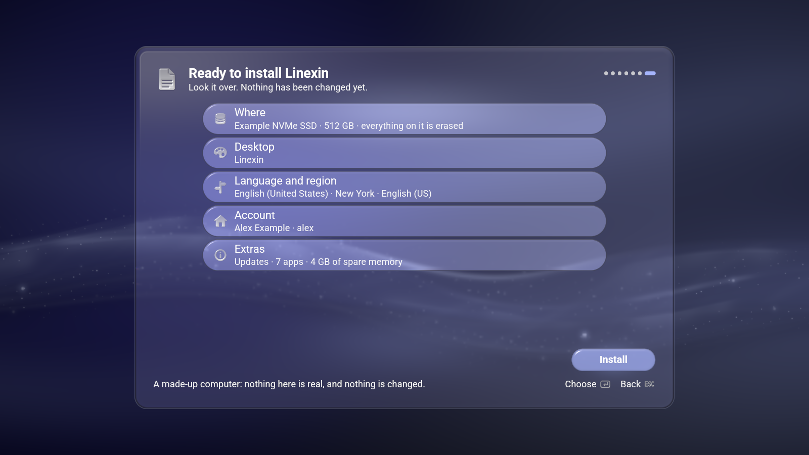
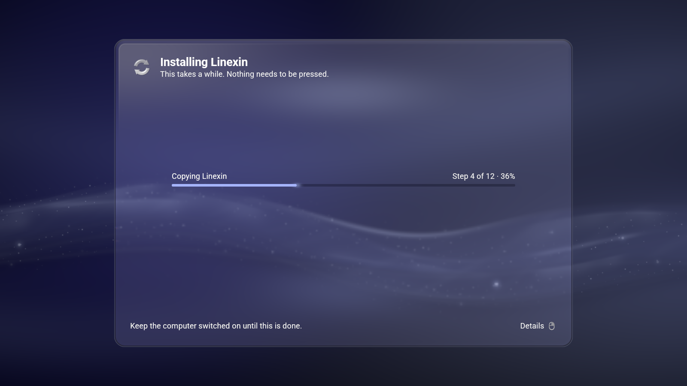
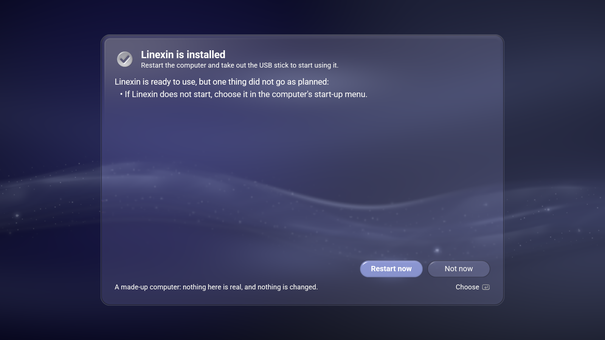

# Linexin Installer

**The installer that puts [Linexin](https://github.com/Petexy) on a computer,
in the [LineXinBar](https://github.com/Petexy/LineXinBar) design language and
fully usable with a controller.**

[](LICENSE)
[](VERSION)
[](Cargo.toml)



`lxb-installer` is the project, the package and the command; **Linexin
Installer** is what it is called on the desktop entry and on the window. It is
built on [lxb-toolkit](https://github.com/Petexy/lxb-toolkit) — the shell's own
colours, glass, motion, type and marks — and it ports the earlier GTK
installer feature for feature, fixing what that one got wrong. It runs from a
Linexin live system: inside a LineXinBar session, which makes it full screen,
or on the GNOME live desktop as an ordinary window. Either way the wallpaper
fills the screen and the installer is one glass panel on it, scaled to the
display.

## What it does

One question per screen, one primary button, and plain words throughout —
"Samsung SSD · 1 TB" and "Windows and 2 other parts", never a device path or a
filesystem name on the face of a panel.

- **Language, time zone and keyboard.** Sixty-five languages in their own
  names, each beside its country's flag, as the earlier installer showed
  them; choosing one of the installer's ten switches its words at once. The
  time zone is a region and a city, guessed from the language; the keyboard a
  layout and its variant, with a field to try it in where a keyboard is
  attached — both walked as LineXinBar's file picker walks a disk, the second
  column opening only once a row of the first is pressed. Each of the three
  has a search field, summoned by North (Y) on a pad, or Y, the Menu key or
  F10 on a keyboard: every letter narrows the list — a language by its own name or its
  English one, a place by its city, country or part of the world (from every
  part of the world at once), a keyboard by its layout and kind — and Accept
  takes what the light lands on.
- **Where to install.** Erase a whole disk, use a gap of free space, or
  replace a partition. A disk that already has an EFI system partition keeps
  it and shares it — the earlier installer made a second one. Beside Windows
  on a small EFI partition, the kernels go on a Linux boot partition of their
  own and the EFI partition holds only the boot loader.
- **Advanced: Partitions.** Every disk laid out as GParted lays one out, in
  GParted's words (`/dev/sda3`, `ntfs`, `931.5 GiB`): a map of tiles, a
  menu on each, sheets for a new partition, a size, a label or a mount
  point of one's own, the pending operations listed and what is still
  missing said. A plan is carried out only where a test in QEMU ran that
  very kind of plan, on that kind of computer and disk, and passed: on a
  computer UEFI starts, a new GPT disk, or several with a /home kept on
  one; partitions made, deleted or formatted beside Windows, one made
  smaller; Windows or an ext4 partition shrunk to make room; an old Linux
  reinstalled with its /home kept. On an older BIOS computer, a new GPT
  disk; an MBR disk keeping a FAT data partition, or reusing its logical
  partitions; or Windows shrunk there, the old Linux reused and its /home
  kept. Anything else — a new MBR table, several disks under BIOS, an MBR
  disk under UEFI, a separate /boot under BIOS, `/` on a logical
  partition, a partition grown that is not a logical one, a disk whose
  sectors are 4096 bytes rather than 512 (every disk the tests ran had
  512-byte ones) — says it can't be applied in this version yet, before
  anything is written.
- **Options**, the earlier installer's every one: Btrfs with snapshots before
  each update (ext4 by default), a swap file of any size or none, a separate
  /home kept or formatted, on this disk or another.
- **The desktop.** Linexin (GNOME, on the medium, no internet needed), Kinexin
  (Plasma) or LineXinBar with its own login screen. Updates during the
  installation, the Flathub apps to add, the image's packages to leave out,
  unused graphics and microcode drivers removed, and the boot loader.
- **The boot loader follows the disk.** systemd-boot with no menu when Linexin
  is alone, rEFInd when another system is found, GRUB on a BIOS computer or an
  msdos disk — and legacy BIOS is supported, which the earlier installer did
  not do.
- **You.** A full name, a username that follows it, a password typed twice
  with its strength shown, the computer's name, and an optional root account,
  in one column, each below the one before.
- **One review, one question.** The plan in a headline and a few rows; then a
  question whose safe answer has the light, naming everything that will be
  erased.
- **Installs with its progress in words** — "Step 4 of 12 · 40%", the log
  behind Details — and ends in **Done** (Restart now first) or **Stopped**,
  which says what was and was not changed.



**Nothing is written until the last answer.** The interface runs as the person
and only reads the machine. Install hands one request to a worker that polkit
starts as root; the worker re-reads the disks and refuses — before writing a
byte — if the disk is not the one that was reviewed, if anything on it is in
use, or if what it would erase is not exactly what the question named.











## Controls

A controller, a keyboard and a pointer are one interface. What the buttons do
is drawn in the corner, as the button that does it: South on a pad is Enter on
a keyboard, and the corner shows whichever was last reached for.

| | Pad | Keyboard |
|---|---|---|
| Move | D-pad or left stick | Arrows |
| Choose | South | Enter |
| Back | East | Escape |
| Options, Details, Search | North | Y, Menu key or F10 |
| Done on the on-screen keyboard | Start | — |

As in LineXinBar, the light follows the pointer: what it rests on is lit, a
click acts on it at once, its right button is Options, and each picture in the
corner is a button a click presses — which is how a mouse gets back out of a
screen whose Back is only drawn there. A field being typed in keeps the light
while the pointer moves; a click or a key moves it on.

With a keyboard in hand a text field takes typing directly. With a pad in
hand, South on a field brings up an on-screen keyboard: under LineXinBar the
shell's own, which every application on it types with, and anywhere else the
installer's. LineXinBar raises its keyboard over a field clicked or tapped as
well, while it still counts a controller in hand. Either way the field typed
into stands above the keyboard while it is up, and the room is given back the
moment it is put away.

## Building

The installer is built with Rust 1.90 or newer against **lxb-toolkit 0.9.4**,
the release its `Cargo.lock` records — the toolkit and the programs built on it
move to each version together — and the toolkit's crate sources are compiled
into the binary. Either install the toolkit — the `lxb-toolkit` package from
the Linexin repository (`linexin-repo`), or one built from
[its own repository](https://github.com/Petexy/lxb-toolkit) with its
`packaging/build.sh` — and build as any Rust program is built:

```sh
cargo build --release --locked
```

or clone lxb-toolkit beside this repository, the two folders side by side,
and build against its tree with nothing installed:

```sh
git clone https://github.com/Petexy/lxb-toolkit ../lxb-toolkit
scripts/toolkit-tree.sh build --release --locked
```

`toolkit-tree.sh` writes a manifest of its own under `target/`, with the
toolkit's path pointed at the tree, so `Cargo.toml` and `Cargo.lock` never
change; `LXB_TOOLKIT_TREE` names a tree that stands anywhere else. Its program
lands in `target/toolkit-tree/release/`, cargo's own in `target/release/`.

Either way the demo — a made-up computer on which nothing is written — runs in
a bubblewrap sandbox with no disk of the computer in reach, and the tests are
cargo's own (what they hold to is under [Verify](#verify)):

```sh
scripts/demo-sandbox.sh --demo
cargo test --locked                      # or: scripts/toolkit-tree.sh test --locked
```

A toolkit newer than the one the lock records — a later package, or a clone
whose `main` has moved on — is refused by every `--locked` command here,
because `--locked` forbids Cargo to write the toolkit's new version into
`Cargo.lock`. Leave `--locked` out to try one: Cargo then writes the new
version in first, into the copy under `target/` when the build goes through
`toolkit-tree.sh`.

## Install

The installer is packaged for **Arch alone**: it installs Linexin, an
Arch-based system, from Linexin's live medium. Build the package with
**a generic toolchain** — in a plain Arch container, never on a host whose
makepkg tunes for its own CPU — with Rust 1.90 or newer and the **lxb-toolkit
0.9.4** package installed (its crate sources under
`/usr/share/lxb-toolkit/crates` are compiled into the binary; nothing of the
toolkit is linked at run time):

```sh
./packaging/build.sh check     # what the package has to agree with
./packaging/build.sh arch      # makepkg, into packaging/out/arch
sudo pacman -U packaging/out/arch/lxb-installer-0.9.4-1-x86_64.pkg.tar.zst
```

Or straight from the checkout, onto the live system you are standing at:

```sh
cargo build --release --locked
sudo ./packaging/install.sh --destdir / --prefix /usr
```

`install.sh` places the binary, the desktop entry, the icon, the AppStream data
and the polkit action — and only at `/usr`, because the worker is raised as
`/usr/bin/lxb-installer`, the path the action names. See
[`packaging/README.md`](packaging/README.md) for the run-time dependencies
(every program the worker runs, checked against its source) and why Arch only.

## Verify

```sh
cargo test --locked
cargo clippy --locked --all-targets -- -D warnings
cargo fmt --check
```

A test build cannot reach the machine even by mistake: every program the
worker's code starts passes a fence first (`fence` in `src/worker/run.rs`) —
those it runs through `run`, lsblk and nmcli, which the model starts itself
(as it does pacman for the Desktop screen), and the read-only measurement's
few, which `--measure` starts itself — and so do its one network connection,
its one look at the computer's firmware, every look at `/sys/class/block`
(a layout's fence, the boot loader's firmware entry and GRUB's BIOS
target, the busy checks' `dev` and `holders` of a device, discovery's
holders), and everything the executor of a layout made on Partitions asks
of the machine (its `Machine` and the udisks rule's hands, whose tests hand
in a machine that writes down what it is asked and runs nothing). The fence
refuses to run anything as root, any argument naming something under
`/dev`, `/proc`, `/sys` or `/run` or holding `..`, standard input naming any
of them, every connection, every reading of the firmware (a test off the
demo is given one) and every look at `/sys/class/block` (a test is given a
kernel, or a device's facts, of its own), and every program but the few
the tests need: printf, a shell only as the two exact command lines its two
tests use, and sfdisk and wipefs only on the image files the partitioning
tests make under `artifacts/`. A test that runs a file system tool on an
image file is `#[ignore]`d and run by name, by hand, only through
`scripts/side-files.sh ext4` (or `ntfs`), which runs it inside bubblewrap —
a `/dev` of null, zero and urandom, no `/sys` or `/run`, every host path an
overlay so `/proc/mounts` names no device, the images on a tmpfs of their own
mounted where the test binary makes them (`images::IMAGES`, under the
manifest `scripts/toolkit-tree.sh` writes in `target/`) — so the
package's `check()` never runs it; the fence runs those tools (the shrink's
e2fsprogs and ntfsprogs, listed by name in `run::fence::ON_SIDE_FILES`, for
the two tests in `worker::manual::side_files`) only for a test binary asked
for the tests set aside, only with the words those tests give them (no blkid
tag, no relative name, no request file), and only on the image the test
made.

The unit tests are pure: no disk, no root, no network, and no reading of the
machine they run on. `--demo` opens the installer on a made-up computer — an
empty NVMe drive, a SATA disk with Windows and room beside it, and the USB
stick it started from, which carries Linexin and LineXinBar as the Linexin 3.0
stick does (Kinexin is downloaded) — where Install only rehearses and nothing
is touched.
`--shot` writes one settled frame of that demo to a PNG with no display at all,
through the same renderer the window uses:

```sh
lxb-installer --demo
lxb-installer --shot review.png --scene review --width 1600 --height 900
```

Every picture in this README was taken that way; the commands are in
[`docs/design.md`](docs/design.md#the-pictures). Away from the live medium no
installation can start and `--worker` and `--measure` refuse, and on a
development machine the demo is run through
[`scripts/demo-sandbox.sh`](scripts/demo-sandbox.sh), a bubblewrap sandbox in
which no disk of the computer can even be seen:

```sh
scripts/demo-sandbox.sh --demo
scripts/demo-sandbox.sh --demo --shot review.png --scene review --width 1600 --height 900
scripts/demo-sandbox.sh --probe        # lsblk, /dev and the system bus, from inside
```

Real installations are proven only in QEMU, on image files, never on a real
disk. Before a release the Linexin live ISO is booted in QEMU with the
installer's package, the installer is walked with the keyboard and installs
onto virtual disks — empty UEFI, BIOS, NVMe, beside Windows, Btrfs, a
separate /home, and every kind of plan Partitions carries out — and each
result is checked and the installed system started on its own.

## Languages

Ten, compiled in: German, English (UK), English (US), Spanish, French, Hindi,
Polish, Brazilian Portuguese, Russian and Simplified Chinese — the session's
language at first, and whichever the person chooses from then on. See
[localization](docs/localization.md).

## How it is put together

| | |
|---|---|
| `src/main.rs` | The command line: the interface, `--demo`, `--shot`, `--list-disks`, the worker, the measurement |
| `src/model/` | Plain data and pure functions: the request, the events, the disks, the catalogs |
| `src/ui/` | The panel, its columns, the legend, the board and every screen |
| `src/launch.rs` | Raising the worker and the read-only measurement through pkexec, only on the live medium, and reading what they say |
| `src/worker/` | The root half: checks, partitions, filesystems, the copy and the system steps |
| `locales/` | The ten Fluent catalogs |
| `data/` | The desktop entry, the icon, the AppStream data, the polkit action, `glyphs/`, the installer's own marks, `flags/`, the Language step's flags (Noto Color Emoji's, under its own licence), and `places/`, Time zone's city and country names in every language (CLDR's, under the Unicode licence) |
| `scripts/` | `demo-sandbox.sh`, the demo with no disk in reach; `toolkit-tree.sh`, a build against lxb-toolkit's source tree; `side-files.sh`, the two file system tests set aside, run by hand in a sandbox; `flags-from-noto.py` and `cldr-places.py`, which made `data/flags/` and `data/places/` and are run again by hand when the font, CLDR or tzdata moves on |

**[`docs/design.md`](docs/design.md)** is the long answer: the two processes and
the request between them, how a disk is laid out in each case, what the system
steps do, and what the interface promises a person.

## Licence

[GPL-3.0-only](LICENSE), matching LineXinBar and the toolkit. It releases under
the same version as LineXinBar, lxb-toolkit, CEDM and the family's other
applications. The Language step's flags (`data/flags/`) are cut out of Noto
Color Emoji and stay under its [SIL Open Font License 1.1](data/flags/LICENSE).
Time zone's city and country names (`data/places/`) are CLDR's, under the
[Unicode licence](data/places/LICENSE).
